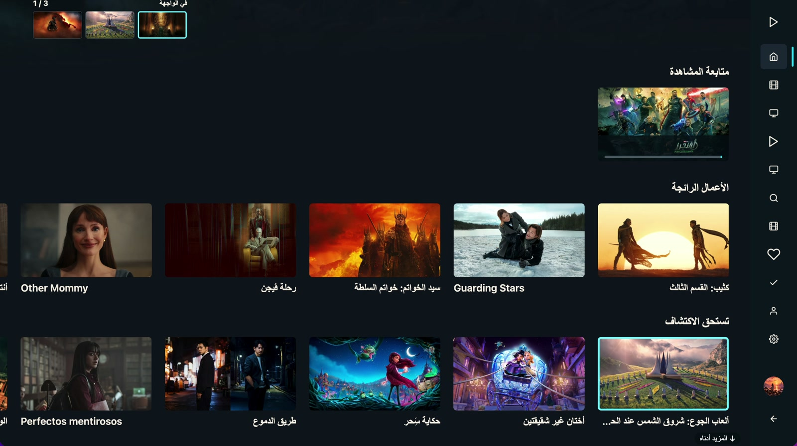

<div dir="rtl" lang="ar">

# إيتار سينما

[English](README.md) · **العربية**

إيتار سينما تطبيق تلفزيوني تجريبي مستقل ومفتوح المصدر، مبني على حزمة [`@bougarnem/itar` المنشورة على npm](https://www.npmjs.com/package/@bougarnem/itar). تصفّح كتالوج المشاهدة وجرّب انتقال التركيز بين الصفوف واستعادته بعد فتح صفحة التفاصيل أو الخروج من المشغّل.

[](docs/images/itar-cinema-preview.mp4)

[شاهد العرض المسجّل من المتصفح (MP4)](docs/images/itar-cinema-preview.mp4)

## ما يمكنك تجربته

- تصفّح الصفحة الرئيسية بالعربية أو الإنجليزية، وجرّب الصفوف من اليمين إلى اليسار والمعاينات وصفوف أفضل عشرة عناوين.
- صفِّ الأفلام والمسلسلات ورتّبها. افتح عنوانًا وتصفّح الحلقات أو أعمال أحد الممثلين، ثم اضغط زر الرجوع للعودة إلى البطاقة التي فتحتها.
- افتح دليل البرامج وتنقّل بين الفترات الزمنية وشغّل قناة مباشرة في مشغّل سينما. جرّب أحد الأفلام المفتوحة لاختبار شريط التقدّم والتشغيل التالي والعناوين ذات الصلة.
- بدّل بين الملفات الشخصية أو احفظ العناوين في «قائمتي» أو غيّر إعدادات صوت المعاينات ولغة التشغيل.

## التشغيل في المتصفح

استخدم Node 22.23.4 وnpm 10.9.9.

```sh
npm ci
npm run web
```

افتح [http://127.0.0.1:8081](http://127.0.0.1:8081)، واختر **تسجيل الدخول**، ثم أرسل النموذج التجريبي واختر ملفًا شخصيًا. استخدم مفاتيح الأسهم لنقل التركيز وEnter للاختيار وEscape للرجوع.

يعمل الكتالوج المضمّن دون اتصال بالإنترنت. لتصفّح البيانات والصور من TMDB، شغّل الخادم الوسيط المحلي واختر **الإعدادات ← مصدر المحتوى ← الكتالوج ← خادم TMDB الوسيط**. راجع [دليل إعداد TMDB](docs/ar/tmdb-proxy.md). تُبثّ الأفلام التجريبية والقنوات المباشرة عبر الشبكة.

## إصدارات التلفزيون

- **Android TV وFire OS** — شغّل `npm run native:generate` ثم `npm start` لتشغيل Metro، وبعد توصيل الجهاز شغّل `npm run android -- --no-packager`.
- **Apple TV** — شغّل `npm run native:generate` ثم `pod install` داخل مجلد `ios`، وافتح `ios/ItarProbe.xcworkspace` أو شغّل `npm run tvos -- --udid YOUR_TVOS_UDID`.
- **Samsung Tizen وLG webOS** — شغّل `npm run build:tizen` أو `npm run build:webos`. استخدم أدوات المنصّة لتحزيم الملفات الناتجة في `build/web/` وتوقيعها.

يستخدم سينما `@bougarnem/itar/react` في إصدارات التلفزيون الأصلية و`@bougarnem/itar/web` في المتصفح وإصدارات تلفزيون الويب. تتضمّن حزمة الويب محرّك التركيز المبني بتقنية WebAssembly.

## التطوير

راجع [دليل التطبيق](docs/ar/ott-app.md) لأمثلة التنقّل والتشغيل، و[ملاحظات التصميم](design/README.ar.md) لتفاصيل الواجهة. شغّل `npm run check` و`npm test` و`npm run typecheck` و`npm run typecheck:web` للتحقّق محليًا.

</div>
