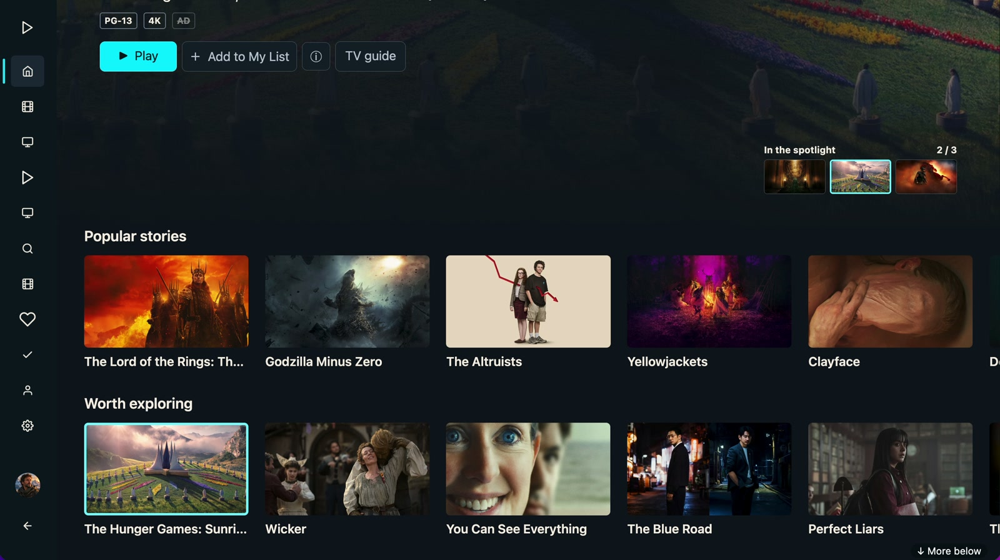

# Itar Cinema

**English** · [العربية](README.ar.md)

Itar Cinema is a standalone, open-source TV demo built with the published [`@bougarnem/itar` npm package](https://www.npmjs.com/package/@bougarnem/itar). Browse a streaming catalogue and see how focus moves and returns as you switch shelves, open a title, or leave the player.

[](docs/images/itar-cinema-preview.mp4)

[Watch the English showcase (MP4)](docs/images/itar-cinema-preview.mp4)

## What to try

- Browse Home in English or Arabic, including right-to-left shelves, featured previews, and Top 10 rows.
- Filter and sort Movies and Series. Open a title, browse episodes or cast credits, then press Back to return to the card you opened.
- Open the TV guide, move between time windows, and tune a live channel in Cinema’s player. Play one of the credited open films to try the timeline, Play Next, and related titles.
- Switch profiles, save titles to My List, or change preview audio and playback language preferences.

## Run in a browser

Use Node 22.23.4 and npm 10.9.9.

```sh
npm ci
npm run web
```

Open [http://127.0.0.1:8081](http://127.0.0.1:8081), choose **Sign in**, submit the demo form, and select a profile. Use the arrow keys to move focus, Enter to select, and Escape to go Back.

The bundled catalogue works offline. To browse live metadata and artwork, start the local proxy and choose **Settings → Content source → Catalogue → TMDB proxy**. See the [TMDB setup guide](docs/tmdb-proxy.md). Demo films and live channels stream over the network.

## TV builds

- **Android TV and Fire OS** — Run `npm run native:generate`, start Metro with `npm start`, then run `npm run android -- --no-packager` with a connected device.
- **Apple TV** — Run `npm run native:generate`, run `pod install` in `ios`, then open `ios/ItarProbe.xcworkspace` or run `npm run tvos -- --udid YOUR_TVOS_UDID`.
- **Samsung Tizen and LG webOS** — Run `npm run build:tizen` or `npm run build:webos`. Use the platform SDK to package and sign the unsigned staging directory under `build/web/`.

Cinema uses `@bougarnem/itar/react` on native TVs and `@bougarnem/itar/web` in browser and web TV builds. The web package includes the WebAssembly focus engine.

## Development

See the [app walkthrough](docs/ott-app.md) for focus and playback examples and the [design notes](design/README.md) for the UI. Run `npm run check`, `npm test`, `npm run typecheck`, and `npm run typecheck:web` for local verification.
